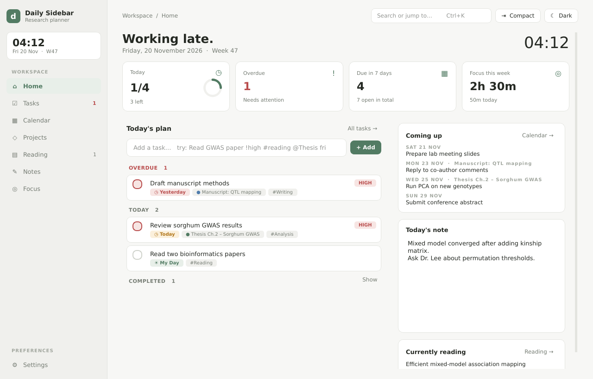
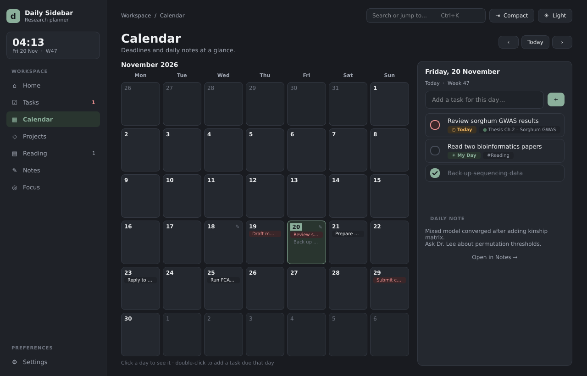
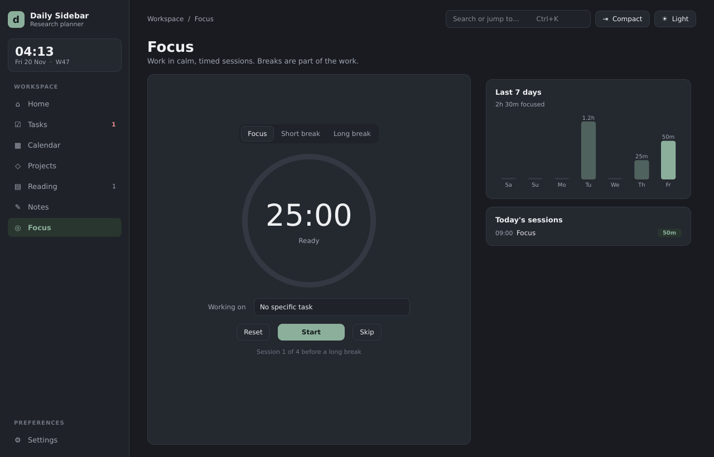
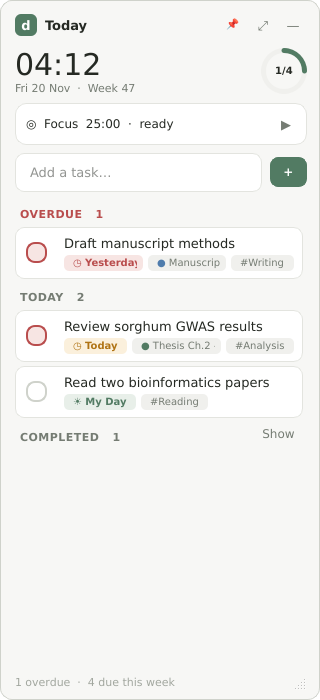

# Daily Sidebar Next

A calm research planner for Windows, built with Python and PySide6 (Qt).
It grows the original Daily Sidebar into a full workspace, and keeps the slim always-on-top sidebar as **compact mode**.



<p>



</p>

## Install

1. Open the [latest release](../../releases/latest) and download **DailySidebarNext-Setup.exe**.
2. Double-click it. If Windows says *"Windows protected your PC"*, click **More info → Run anyway** (the app isn't code-signed yet).
3. Choose **Install for all users** (installs to `C:\Program Files\Daily Sidebar Next`, Windows asks for permission once)
   or **Install for me only** (no admin needed, installs to `%LOCALAPPDATA%\Programs`).
4. Tick *desktop shortcut* and, if you like, *start when I sign in*. Click **Install**.

You don't need Python. Open the app from the Start menu or the desktop icon.
Uninstall it from **Settings → Apps → Installed apps → Daily Sidebar Next**.
Your tasks and notes are kept in `%APPDATA%\DailySidebarNext`, so updating or uninstalling never deletes them.
To update, just run a newer Setup.exe over the old one.

Prefer no installer? The release also has **DailySidebarNext-windows.zip**: unzip it somewhere permanent and run `DailySidebarNext.exe`.

### Publish a new version (GitHub builds the installer for you)

1. On GitHub go to **Releases → Draft a new release**.
2. In *Choose a tag*, type a new version such as `v2.0.2` and pick *Create new tag on publish*. Click **Publish release**.
3. The **Actions** tab runs the build (about 5–8 minutes). It runs the tests, builds the app with PyInstaller,
   wraps it in the Inno Setup installer and attaches **DailySidebarNext-Setup.exe** and the zip to that release.
   The tag sets the version number, so you don't need to edit any file.

Every push to `main` also builds the installer; you can download it from that run's *Artifacts* section to test it.

### Build the installer on your own PC

1. Install Python 3.10 or newer from python.org.
2. Double-click **build_installer.bat**. It installs Inno Setup (with winget) if it's missing, builds the app and
   creates `dist\DailySidebarNext-Setup.exe`.
3. Run the setup. After that you can delete the source folder; the installed app doesn't need it.

## Run from source

From this folder in PowerShell:

```powershell
# uses the .venv one folder up (the starter's), or create one here
..\.venv\Scripts\python.exe main.py
```

Or double-click **run.bat** (no console window).

First time on a new machine:

```powershell
py -m venv .venv
.\.venv\Scripts\Activate.ps1
pip install -r requirements.txt   # PySide6-Essentials; full PySide6 works too
python main.py
```

Build a standalone app with **build_exe.bat** (creates `dist\DailySidebarNext\DailySidebarNext.exe`).

## What's inside

| Page | What it does |
|---|---|
| **Home** | Greeting, live clock and week number, today's progress, overdue count, deadlines in the next 7 days, focus time this week, today's plan, coming up, today's note, currently reading |
| **Tasks** | Quick add with shortcuts, views for Today, Upcoming, Overdue, All open and Done, filters by category and project, tasks grouped by Overdue, Today, Tomorrow, This week and Later |
| **Calendar** | Month grid with deadlines and daily-note markers. Click a day to see its tasks and note, double-click to add a task due that day |
| **Projects** | Project cards with colour, status, deadline and progress. Open one to see and add its tasks |
| **Reading** | Papers and books with status (To read, Reading, Read), authors, year, venue, DOI or link, rating, tags and notes. Paste a DOI to add one quickly |
| **Notes** | A daily research log (with a template) and a notebook with pinning, a meeting template and search. Saved as you type |
| **Focus** | Pomodoro timer (focus, short and long breaks) linked to a task, last 7 days chart, today's sessions. Keeps running on other pages |
| **Settings** | Theme (system, light or dark), 6 accent colours, timer lengths, compact sidebar options, start with Windows, close to tray, export and import |

**Also:**
- **Compact sidebar** (Ctrl+M or ⇥ Compact): a slim panel with the clock, today's tasks, quick add and the focus timer. You can drag it, it snaps to screen edges, double-click its top to dock it right, and pin it on top.
- **Ctrl+K** searches tasks, projects, papers and notes, and runs commands.
- **Tray icon:** closing the window keeps the app running in the tray (you can turn this off).
- Repeating tasks (daily, weekdays, weekly, monthly). Unfinished "My Day" tasks roll over to today.
- Undo after you complete or delete a task.
- Right-click a task to set its due date or priority, move it to a project, or start a focus session on it.

### Quick-add syntax

```
Read GWAS paper !high #reading @Thesis fri *weekly
```

| Type | Meaning |
|---|---|
| `!high` `!low` | priority |
| `#reading` | category |
| `@Thesis` | project (matches an existing one, or creates it; use `_` for spaces) |
| `today` `tomorrow` `fri` `+3` `12/03` `2026-12-01` | due date |
| `*daily` `*weekdays` `*weekly` `*monthly` | repeat |

### Keyboard shortcuts

| Keys | Action |
|---|---|
| Ctrl+K | Search and commands |
| Ctrl+N | New task |
| Ctrl+Shift+N | New note |
| Ctrl+1 … Ctrl+8 | Switch page |
| Ctrl+M | Compact sidebar |
| Ctrl+D | Light / dark |
| Ctrl+Shift+F | Start or pause focus |

## Your data

Everything is stored locally in `%APPDATA%\DailySidebarNext\data.db` (SQLite).
A backup copy is made each day in `backups\` next to it, and the last 10 are kept.
Settings → *Export backup* writes everything to a readable JSON file.

**Coming from the first Daily Sidebar?** On first start the app offers to import your tasks and daily notes from
`%APPDATA%\DailySidebar\data.json`. The old file is only read, never changed. You can also do it later
from Settings → *Import from Daily Sidebar*.

To use a different data file: `python main.py D:\path\to\my.db`.

## Code layout

```
main.py                    start-up, single instance
dailysidebar/store.py      SQLite storage, quick-add parser, import/export (no Qt; tested)
dailysidebar/theme.py      palettes and stylesheet
dailysidebar/widgets.py    task rows, lists, quick add, charts, toast
dailysidebar/dialogs.py    task / project / paper dialogs, Ctrl+K palette
dailysidebar/window.py     main window, navigation, tray, shortcuts
dailysidebar/mini.py       compact sidebar
dailysidebar/pages/        one file per page
tests/                     python -m unittest discover -s tests
```

## Releasing a new version

1. Change `__version__` in `dailysidebar/__init__.py` and add notes to `CHANGELOG.md`.
2. Commit, then tag and push: `git tag v2.0.2 && git push origin v2.0.2`.
3. GitHub Actions runs the tests, builds the Windows app and attaches `DailySidebarNext-Setup.exe` and `DailySidebarNext-windows.zip` to a new Release.

## License

[MIT](LICENSE)
